<!-- ==================== [ 00 ] NEO-BRUTALIST SVG HERO HEADER ==================== -->

  

<!-- ==================== HIGH-CONTRAST TYPING TERMINAL BAR ==================== -->

  

<!-- ==================== INFINITE SCROLLING BRUTALIST TICKER ==================== -->

  

 

<!-- ==================== BRUTALIST SOCIAL & COMMAND BAR ==================== -->

  
  
  
  
  
  

  
  
  

 

<!-- ==================== LIVE BACKGROUND COLOR-SHIFTING QUOTE SLAB ==================== -->

  

 

<!-- ==================== [ 01 ] EXECUTIVE SUMMARY ==================== -->

  

 

Systems-minded **AI & Data Engineer** and **Full-Stack Architect** building resilient data pipelines, production RAG engines, and high-craft web platforms. My work bridges distributed data infrastructure—**Medallion lakehouses, Kafka streaming, and Databricks**—with intuitive, high-contrast user interfaces. Great engineering merges mathematical rigor with unmistakable visual clarity.

> **`AXIOM_00:`** *"Simplicity is prerequisite for reliability. Complexity is easy to build; clarity is what scales."*

 

<!-- ==================== [ 02 ] CURRENT FOCUS & ENGINEERING SCALE ==================== -->

  

 

| `PILLAR` | `ACTIVE ARCHITECTURE` | `CORE ENGINE` |
| :--- | :--- | :--- |
| **`01 / LAKEHOUSE & GENAI`** | Automated **Medallion Architecture** (`Bronze → Silver → Gold`) feeding a hybrid **RAG + Text-to-SQL** assistant | `Apache Airflow` · `Azure Blob` · `Groq LLM` · `FastAPI` · `Next.js` |
| **`02 / REAL-TIME STREAMING`** | High-throughput event ingestion and stateless micro-batch filtering with live BI telemetry | `Confluent Kafka` · `Spark Streaming` · `Databricks` · `PostgreSQL` |
| **`03 / PRODUCT & FRAMEWORKS`** | Experimental TypeScript UI compilers, multimodal AI interfaces, and modular enterprise architectures | `TypeScript` · `React` · `Docker` · `Kubernetes` |

 

<!-- ==================== [ 03 ] TECHNOLOGY ECOSYSTEM ==================== -->

  

 

| `DOMAIN` | `TECHNOLOGIES & TOOLING` |
| :--- | :--- |
| **`AI, ML & LLMS`** |       |
| **`DATA ENGINEERING`** |      |
| **`FULL-STACK & APIS`** |         |
| **`DATABASES`** |       |
| **`CLOUD & DEVOPS`** |        |

 

<!-- ==================== [ 04 ] FLAGSHIP ARCHITECTURES & FEATURED WORK ==================== -->

  

 

<table>
  <tr>
    <td width="50%" valign="top">
        
      
End-to-end containerized data lakehouse orchestrating Bronze, Silver, and Gold pipelines with automated LLM enrichment, vector embeddings, and a dual RAG + SQL conversational interface.

      

        <kbd>Airflow</kbd> <kbd>Azure</kbd> <kbd>Groq LLM</kbd> <kbd>FastAPI</kbd> <kbd>Next.js</kbd>
      

      <a href="https://github.com/chroll0ps?tab=repositories"><b>[ EXPLORE ARCHITECTURE ↗ ]</b></a>
    </td>
    <td width="50%" valign="top">
        
      
Distributed IoT event streaming architecture ingesting live urban telemetry through Kafka and Spark Structured Streaming into PostgreSQL with live Power BI DirectQuery visualization.

      

        <kbd>Kafka</kbd> <kbd>Spark Streaming</kbd> <kbd>PostgreSQL</kbd> <kbd>Power BI</kbd>
      

      <a href="https://github.com/chroll0ps?tab=repositories"><b>[ EXPLORE ARCHITECTURE ↗ ]</b></a>
    </td>
  </tr>
  <tr>
    <td width="50%" valign="top">
        
      
Experimental front-end UI framework and custom compiler engineered from scratch in TypeScript to explore reactive rendering primitives, AST compilation, and minimal runtime footprints.

      

        <kbd>TypeScript</kbd> <kbd>AST Compiler</kbd> <kbd>UI Systems</kbd>
      

      <a href="https://github.com/chroll0ps?tab=repositories"><b>[ EXPLORE REPOSITORY ↗ ]</b></a>
    </td>
    <td width="50%" valign="top">
        
      
Conversational goal-intelligence platform powered by Gemini Pro, combining multimodal voice-to-text processing, image journaling, and adaptive personal insights.

      

        <kbd>Gemini Pro</kbd> <kbd>Multimodal AI</kbd> <kbd>Full-Stack</kbd>
      

      <a href="https://github.com/chroll0ps?tab=repositories"><b>[ EXPLORE REPOSITORY ↗ ]</b></a>
    </td>
  </tr>
  <tr>
    <td width="50%" valign="top">
        
      
Full-stack MERN intelligence platform integrating a Scikit-Learn Random Forest predictive engine with role-based KPI dashboards and automated early-warning diagnostics.

      

        <kbd>MERN Stack</kbd> <kbd>Scikit-Learn</kbd> <kbd>Predictive ML</kbd>
      

      <a href="https://github.com/chroll0ps?tab=repositories"><b>[ EXPLORE REPOSITORY ↗ ]</b></a>
    </td>
    <td width="50%" valign="top">
        
      
Cloud-native Confluent Kafka → Databricks → Neon PostgreSQL streaming architecture alongside <b>MelodyMac</b>, an AI-enhanced full-stack cloud learning platform.

      

        <kbd>Confluent</kbd> <kbd>Databricks</kbd> <kbd>Neon PG</kbd> <kbd>Cloud AI</kbd>
      

      <a href="https://github.com/chroll0ps?tab=repositories"><b>[ EXPLORE REPOSITORIES ↗ ]</b></a>
    </td>
  </tr>
</table>

 

<!-- ==================== [ 05 ] IMPACT & ENGINEERING FOOTPRINT ==================== -->

  

 

| `DIMENSION` | `MILESTONE` | `SCOPE` |
| :--- | :---: | :--- |
| **`ENTERPRISE DELIVERY`** | **`PRODUCTION SYSTEMS`** | Built React & Node.js features at **OCP** and architected business software workflows at **Radees** |
| **`DATA & STREAMING`** | **`END-TO-END PIPELINES`** | Kafka Connect, Spark Structured Streaming, Airflow Orchestration, Databricks & Unity Catalog |
| **`CLOUD & AI CERTS`** | **`MULTI-CLOUD CERTIFIED`** | Verified credentials across **Databricks**, **Oracle Cloud (OCI)**, **AWS**, and **AI / Deep Learning** |
| **`ARCHITECTURE STYLE`** | **`MODULAR & HIGH-CONTRAST`** | Enterprise patterns, clean API contracts, neo-brutalist & Shadcn-inspired UX |

 

<!-- ==================== [ 06 ] LIVE GITHUB TELEMETRY & ANIMATIONS ==================== -->

  

 

  
  

   
  

   
  <!-- CUSTOM NEO-BRUTALIST PALETTE SNAKE -->
  <picture>
    <source media="(prefers-color-scheme: dark)" srcset="https://raw.githubusercontent.com/chroll0ps/chroll0ps/output/github-contribution-grid-snake-dark.svg" />
    <source media="(prefers-color-scheme: light)" srcset="https://raw.githubusercontent.com/chroll0ps/chroll0ps/output/github-contribution-grid-snake.svg" />
    
  </picture>

   
  <!-- SHARP HIGH-CONTRAST ACTIVITY GRAPH -->
  

 

<!-- ==================== [ 07 ] VERIFIED CERTIFICATIONS & RECOGNITION ==================== -->

  

 

| `TAG` | `CREDENTIAL / EXPERIENCE` | `ISSUER / ORG` | `DOMAIN & IMPACT` |
| :---: | :--- | :---: | :--- |
| **`GENAI`** | **Databricks Generative AI Fundamentals** |  | LLM workflows, RAG architectures, vector search & Mosaic AI evaluation |
| **`AI SEC`** | **Databricks AI Security Fundamentals** |  | AI governance, Unity Catalog controls, data privacy & LLM threat defense |
| **`CLOUD`** | **OCI Architect Associate** |  | High-availability cloud architecture, networking, IAM & distributed storage |
| **`CLOUD`** | **OCI Foundations Associate** |  | Core cloud infrastructure, security posture & enterprise cloud operations |
| **`CLOUD`** | **AWS Cloud Practitioner Essentials** |  | Cloud-native architectures, compute/storage scaling & Well-Architected principles |
| **`AI/ML`** | **Data Science, ML & Deep Learning (3×)** |  | PyTorch neural nets, Scikit-Learn predictive engines & statistical modeling |
| **`PROD`** | **Software Engineering** |  | Shipped production React & Node.js modules in cross-functional Product & QA squads |
| **`SYS`** | **Systems & Business Workflows** |  | Translated complex operational requirements into structured software architectures |

 

<!-- ==================== [ 08 ] ENGINEERING PHILOSOPHY ==================== -->

  

 

> **`01.`** *"Data is the raw material of intelligence; architecture is what turns noise into signal."*
>
> **`02.`** *"We shape our systems, and thereafter our systems shape how fast we can think."*

 

<!-- ==================== [ 09 ] LET'S BUILD SOMETHING ICONIC ==================== -->

  

 

I collaborate with engineers, founders, and technical teams on **AI/RAG Architectures**, **Real-Time Data Streaming**, **Open-Source Tooling**, and **High-Impact Architecture Reviews**.

   
  
  
  

 

<!-- ==================== FOOTER: VIEWS COUNTER + LAST DEPLOY + NEO-BRUTALIST SVG ==================== -->

  
  

   
  

